# Bitácora de Registro Técnico y Evidencias - TP02

**Materia:** Programación I

**Institución:** Universidad Argentina de la Empresa (UADE)

**Comisión:** Miércoles TM

**Integrantes:**

- Uriel Aguilera Martínez

- Valentino Segatori

- Juan Cruz Ali

**Docente:** Ing. María Eugenia Varando

**Repositorio local:** `C:\Luigis\Portafolio\Trabajo_Practico_Robot`

---

## 1. Preguntas previas (Sección 3 del Orientador)

- **a) ¿Qué herramientas necesita el TP?** Necesitamos Python para programar las instrucciones, el simulador físico MuJoCo para ver el modelo 3D del robot en la computadora, Visual Studio Code para escribir el código y la terminal de comandos para ejecutar todo.

- **b) ¿Qué versión de Python se requiere?** Se pide Python 3.10 o superior (en nuestro sistema usamos Python 3.14.7 de 64 bits).

- **c) ¿Qué componentes ya están instalados en la computadora?** Ya estaban instalados Microsoft Windows 11 Home, Visual Studio Code, Git, Python y su administrador de paquetes pip.

- **d) ¿Qué componentes del repositorio oficial de Unitree no son necesarios para este laboratorio?** No hace falta instalar CycloneDDS ni el paquete SDK oficial de Unitree en C++. El laboratorio de UADE preparó todo para que usemos Python directamente comunicándose por red local con MuJoCo.

- **e) ¿Qué diferencias observan entre el TP en PDF y la versión actual del repositorio?** En el PDF viejo las órdenes se daban por distancia a recorrer o ángulo de giro. En cambio, en esta versión del repositorio se controla todo mediante velocidad y tiempo (avanzar a cierta velocidad por tantos segundos, o girar a cierta velocidad por tantos segundos). Además, en los giros un valor positivo dobla hacia la izquierda y un valor negativo hacia la derecha.

---

## 2. Etapa 1: Caracterización del entorno (Sección 4 del Orientador)

Se relevaron los datos reales del sistema ejecutando las instrucciones básicas por consola antes de comenzar las modificaciones técnicas:

| Elemento | Información obtenida |
| :--- | :--- |
| **Sistema operativo** | Microsoft Windows 11 Home |
| **Versión del sistema operativo** | Windows 11 Home |
| **Arquitectura** | 64 bits (x64-based PC) |
| **Python instalado** | Sí |
| **Versión de Python** | Python 3.14.7 |
| **pip disponible** | Sí (pip 26.3) |
| **Git disponible** | Sí (git version 2.55.0.windows.4) |
| **MuJoCo previamente instalado** | Sí (versión 3.17.0) |
| **IDE utilizado** | Visual Studio Code |
| **Observaciones** | None |

#### Evidencia del Entorno Inicial:

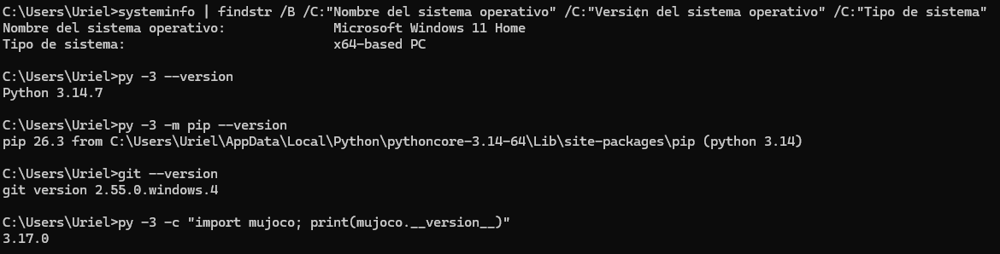

---

## 3. Etapa 2: Obtención del repositorio (Sección 5 del Orientador)

Se descargó el repositorio oficial de la cátedra para trabajar sobre la estructura del laboratorio:

- **Método utilizado:** Clonación local del repositorio oficial [https://github.com/tsamaan/UadeRobotLab.git](https://github.com/tsamaan/UadeRobotLab.git).

- **Ubicación de trabajo:** Carpeta `05LaboratoriosTPs/TP02_Programacion_I/`.

- **Documentación base revisada:** Lectura de las instrucciones de `INSTALACION.md` y `LEEME_ESTUDIANTE.md`.

#### Evidencia del Repositorio Obtenido:

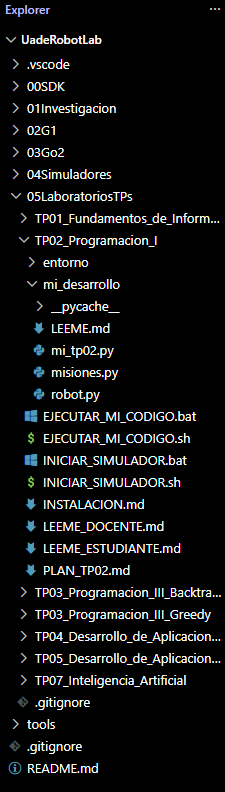

---

## 4. Arquitectura del Laboratorio (Sección 12 del Orientador)

El circuito de comunicación entre nuestro código y el robot virtual funciona de la siguiente manera:

```text
mi_tp02.py (Nuestro programa: menú interactivo y control de órdenes)
    │
    │ robot.avanzar(...) / robot.girar(...) / robot.detenerse()
    ▼
robot.py (Archivo puente de la cátedra: traduce las funciones)
    │
    │ Conexión local interna
    ▼
Gemelo Digital (Simulador MuJoCo + modelo 3D del perro robot Go2)
```

El archivo `robot.py` funciona como un intermediario o puente que no se debe modificar: toma nuestras órdenes desde `mi_tp02.py` y se las manda a través de un canal de red local cerrado al simulador gráfico para que el robot se mueva.

---

## 5. Registro y análisis de problemas (Secciones 8 y 9 del Orientador)

### Tabla de Seguimiento Técnico

| N.° | Acción / Comando | Resultado Obtenido | Problema Detectado | Solución Aplicada | Estado |
| :---: | :--- | :--- | :--- | :--- | :---: |
| **1** | `cd entorno && python3 ...` | `ParserError: El token '&&' no es válido` | La consola de Windows (PowerShell) no entiende el operador `&&` | Separar los comandos usando el punto y coma (`;`) | **RESUELTO** |
| **2** | `cd entorno` | `ItemNotFoundException: PathNotFound` | La consola estaba parada en OneDrive y la carpeta no existía ahí | Mudar el proyecto a una ruta fija en el disco local | **RESUELTO** |
| **3** | `from_xml_path(...)` | `ValueError: ParseXML: Error opening file` | El simulador falla al leer rutas que tengan letras con tildes (`ó`) | Ubicar el proyecto en una ruta limpia sin tildes ni caracteres raros | **RESUELTO** |
| **4** | `py -3 mi_tp02.py` | `sim.robot.NoHaySimulador` | El programa se ejecutó sin haber abierto antes el simulador | Iniciar primero la ventana 3D y luego correr el código | **RESUELTO** |
| **5** | `py -3 mi_tp02.py` | Conexión y desconexión inmediata en 0 segundos | El archivo en disco estaba vacío o sin guardar (`pass`) | Completar las funciones, programar el menú y guardar | **RESUELTO** |

---

### Detalle de Problemas y Evidencias

### Problema 1: Error de sintaxis por operador `&&` en PowerShell

- **Qué se estaba intentando hacer:** Entrar a la carpeta del simulador y probar que todo esté instalado en una misma línea de consola.

- **Comando ejecutado:** `cd entorno && python3 -m sim --solo-revisar`

- **Mensaje de error:** `El token '&&' no es un separador de instrucciones válido en esta versión.`

- **Explicación simple:** La consola de Windows no reconoce el símbolo `&&` para encadenar dos acciones seguidas como lo hace Linux. Al no entender qué significa ese símbolo en el medio de la frase, la terminal se traba y no hace nada.

- **Solución aplicada:** Cambiar el `&&` por el punto y coma (`;`), que es la forma correcta en la que la consola de Windows sabe que primero tiene que terminar una acción y después arrancar la otra (`cd ...\entorno; py -3 -m sim --solo-revisar`).

#### Evidencia del Error:

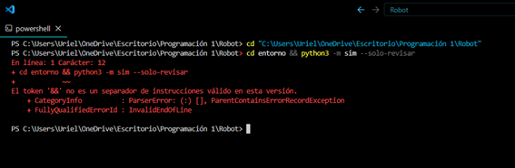

#### Evidencia de la Solución:

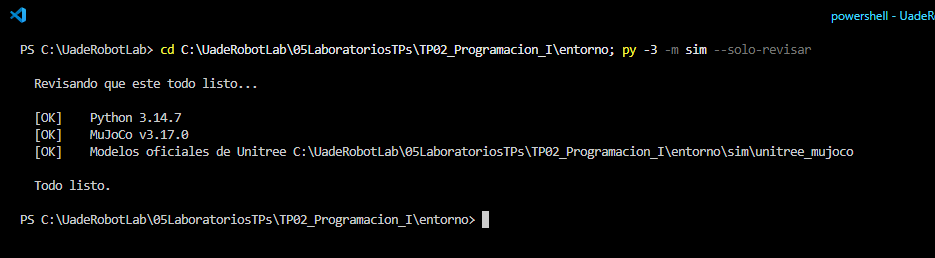

---

### Problema 2: Error de ruta de acceso inexistente (`PathNotFound`)

- **Qué se estaba intentando hacer:** Moverse hacia la carpeta donde están los archivos del simulador usando el comando `cd`.

- **Comando ejecutado:** `cd entorno` y `cd 05LaboratoriosTPs\TP01_Fundamentos_de_Informatica`

- **Mensaje de error:** `cd : No se encuentra la ruta de acceso ... porque no existe.`

- **Explicación simple:** La consola estaba parada dentro de las carpetas sincronizadas de OneDrive (`...\Escritorio\Programación 1\Robot`). Como la estructura de carpetas ahí adentro era distinta y no existía la carpeta `entorno` en ese lugar, el sistema avisó que la ruta no existía.

- **Solución aplicada:** Sacar el proyecto completo de OneDrive y guardarlo en una carpeta propia y fija en el disco (`C:\Luigis\Portafolio\Trabajo_Practico_Robot`), verificando la ubicación con el comando `pwd`.

#### Evidencia del Error:

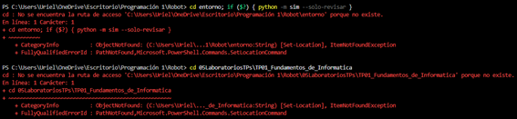

#### Evidencia de la Solución:

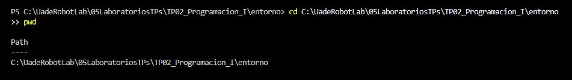

---

### Problema 3: Error al abrir el archivo del modelo 3D (`ParseXML`)

- **Qué se estaba intentando hacer:** Cargar el archivo de configuración 3D del robot (`scene_uade.xml`) para que MuJoCo lo pueda dibujar en pantalla.

- **Comando ejecutado:** `py -3 -c "import mujoco; m = mujoco.MjModel.from_xml_path(...)"`

- **Mensaje de error:** `ValueError: ParseXML: Error opening file`

- **Explicación simple:** El programa interno de MuJoCo está escrito en un lenguaje (C++) que se confunde cuando en el nombre de una carpeta hay tildes o letras especiales. Al tener la palabra `Programación 1` con tilde en la ruta de OneDrive, el motor no pudo leer el archivo XML y falló la apertura.

- **Solución aplicada:** Mover el proyecto a una ruta local sin tildes ni caracteres especiales (`C:\Luigis\Portafolio\Trabajo_Practico_Robot`) y comprobar la carga directa del archivo.

#### Evidencia del Error:

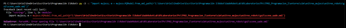

#### Evidencia de la Solución:

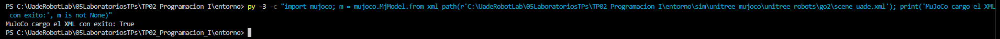

---

### Problema 4: Falta de conexión con el simulador (`NoHaySimulador`)

- **Qué se estaba intentando hacer:** Ejecutar nuestro script de control en Python.

- **Comando ejecutado:** `py -3 mi_tp02.py`

- **Mensaje de error:** `sim.robot.NoHaySimulador: No encuentro el simulador.`

- **Explicación simple:** El programa de Python intentó mandar órdenes por la red interna de la máquina, pero la ventana del simulador 3D estaba cerrada, por lo que no había nadie del otro lado para recibir los comandos.

- **Solución aplicada:** Abrir primero el simulador con `.\INICIAR_SIMULADOR.bat` en una terminal para que levante la ventana gráfica 3D, y recién después correr el programa desde otra terminal separada.

#### Evidencia del Error:

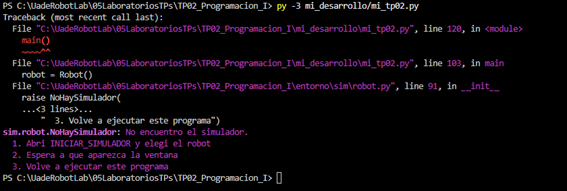

#### Evidencia de la Solución:

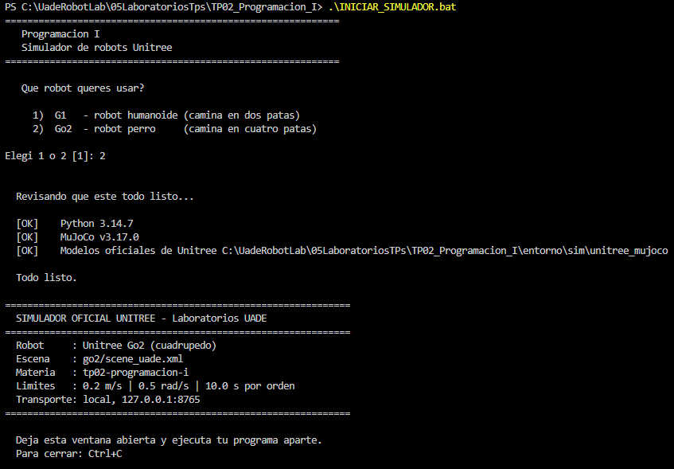

---

### Problema 5: Conexión y desconexión inmediata por archivo sin guardar

- **Qué se estaba intentando hacer:** Probar el movimiento del robot en el simulador.

- **Comando ejecutado:** `py -3 mi_tp02.py`

- **Resultado obtenido:** `[OK] Conectado a Unitree Go2 (perro)` seguido de inmediato por `[OK] Desconectado.`

- **Explicación simple:** El archivo en el disco todavía tenía funciones vacías con la palabra `pass` porque no se habían guardado los cambios del editor. Entonces el programa conectaba y, como no tenía nada para hacer, se cerraba en el mismo segundo.

- **Solución aplicada:** Completar las funciones de validación de órdenes, programar el menú interactivo con bordes visibles y guardar físicamente el archivo `mi_tp02.py`.

#### Evidencia del Error:

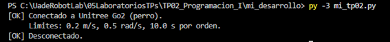

#### Evidencia de la Solución:

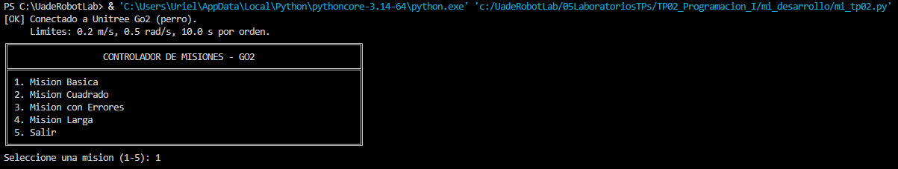

---

## 6. Pruebas obligatorias y validación del controlador (Sección 16 del Orientador)

Se ejecutaron las pruebas progresivas del simulador para verificar que el robot realice los movimientos y que el sistema procese y reporte correctamente las misiones:

### 6.1. Misión Básica

Prueba de movimientos lineales y giros elementales sin errores de parámetros.

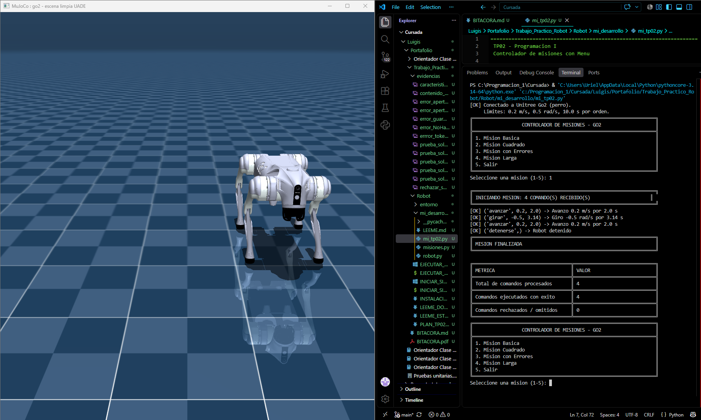

---

### 6.2. Misión Cuadrado

Recorrido en trayectoria cuadrada combinando avances y giros en ángulo recto.

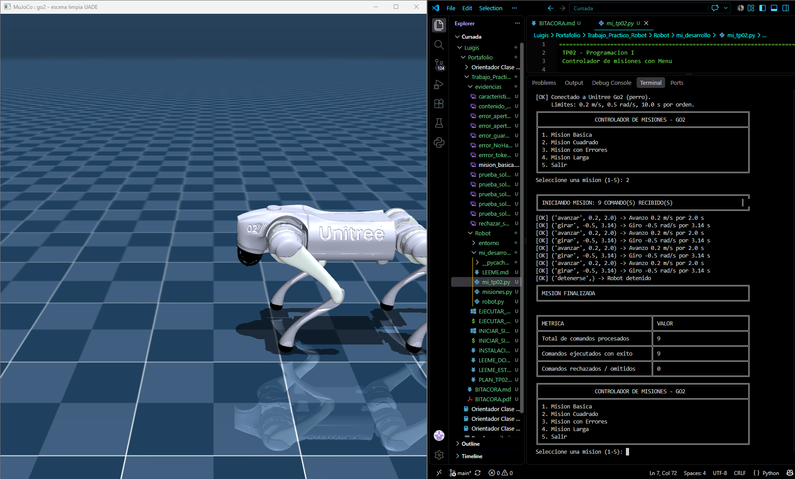

---

### 6.3. Misión con Errores (Detección y Rechazo)

Procesamiento de órdenes inválidas para comprobar la seguridad del sistema:

- **Detección:** Se detectaron comandos fuera de los límites (velocidad mayor a 0.20 m/s o tiempo superior a 10.0 s), órdenes inexistentes (`volar`) y tipos no numéricos.

- **Rechazo:** Cada comando erróneo fue rechazado sin abortar la ejecución del programa.

- **Reporte:** Se emitió la tabla final indicando 11 órdenes procesadas (4 exitosas y 7 rechazadas).

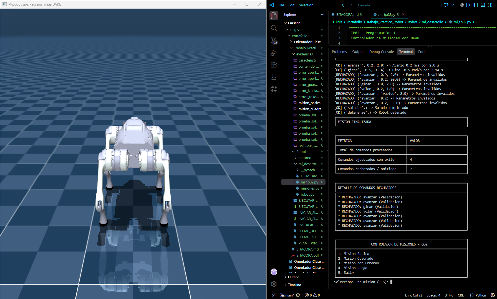

---

### 6.4. Misión Avanzada / Propia

Ejecución de la misión extendida de control validando secuencias de giros, avances y saludo del robot con su reporte final.

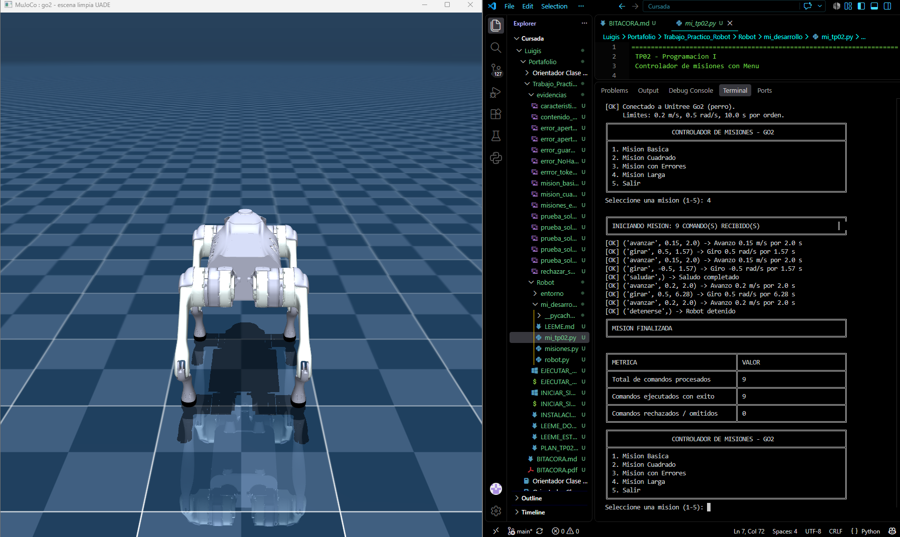

---

## 7. Niveles de avance alcanzados (Sección 17 del Orientador)

| Nivel | Meta requerida | Estado |
| :---: | :--- | :---: |
| **1** | Python reconocido | **ALCANZADO** |
| **2** | MuJoCo importado correctamente | **ALCANZADO** |
| **3** | Modelos Go2 disponibles | **ALCANZADO** |
| **4** | Verificación del entorno correcta | **ALCANZADO** |
| **5** | Ventana MuJoCo abierta | **ALCANZADO** |
| **6** | Go2 visible en 3D | **ALCANZADO** |
| **7** | Programa conectado al simulador | **ALCANZADO** |
| **8** | MISION_BASICA ejecutada | **ALCANZADO** |
| **9** | MISION_CON_ERRORES procesada sin abortar | **ALCANZADO** |
| **10** | Reporte final generado en consola | **ALCANZADO** |

**Nivel máximo alcanzado:** **Nivel 10 (Completo)**.

---

## 8. Cierre y Reflexión Técnica (Sección 20 del Orientador)

- **a) ¿Cuál fue la principal dificultad de instalación?** La mayor dificultad fue el conflicto con OneDrive. Al guardar la carpeta en el Escritorio sincronizado, se generaban bloqueos de escritura y las rutas tenían caracteres con tilde (`Programación 1`), lo que impedía que el simulador pudiera abrir los archivos del modelo 3D.

- **b) ¿Qué error requirió mayor investigación?** El error `ValueError: ParseXML`. Al principio parecía que MuJoCo estaba mal instalado, pero al revisar la consola vimos que el motor interno no puede leer nombres de carpetas con acentos.

- **c) ¿Qué solución resultó efectiva y por qué?** Mudar el proyecto completo a una carpeta local fuera de OneDrive (`C:\Luigis\Portafolio\Trabajo_Practico_Robot`). Al ser una ruta limpia y sin caracteres raros, se solucionaron los problemas de lectura de archivos y los permisos de guardado en el editor.

- **d) ¿Qué intento no funcionó y qué aprendieron de él?** Intentar correr comandos encadenados con `&&` en PowerShell. Aprendimos que la terminal de Windows tiene sus propias reglas y que para poner dos órdenes juntas hay que separarlas con punto y coma (`;`).

- **e) ¿Qué diferencia encontraron entre una guía antigua y la arquitectura actual?** Las guías viejas pedían compilar librerías complejas como CycloneDDS o el SDK de Unitree. El entorno actual de UADE está preparado para funcionar directamente conectando Python con MuJoCo mediante un socket local, lo que hace la instalación mucho más rápida y limpia.

- **f) ¿Hasta qué nivel lograron avanzar?** Logramos llegar al **Nivel 10**: tenemos el entorno validado, el gemelo digital en 3D funcionando, todas las misiones probadas con éxito y el reporte de órdenes funcionando en pantalla.

- **g) Si tuvieran que continuar trabajando, ¿cuál sería el próximo paso?** El paso siguiente sería guardar el historial de cada misión en un archivo permanente (`.txt` o `.csv`) y agregar comandos para leer sensores de distancia que le permitan al robot esquivar obstáculos por su cuenta.
